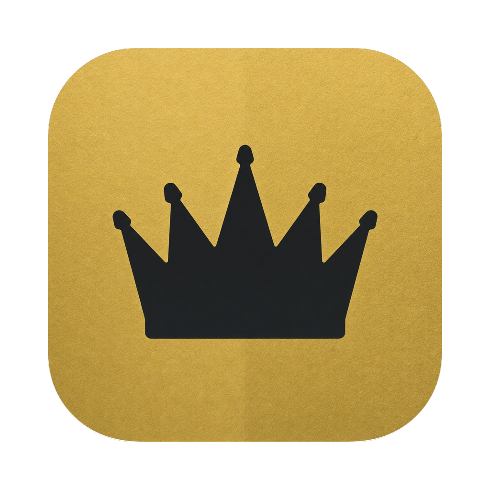

# Sovereign

**Memory you can audit for the AI tools you use, kept as plain files you own.**

**Status: closed beta.** The current app is Sovereign 0.8.0 (build 51), built from this repo and in daily use by its maintainer. A signed, notarized download is on the [releases page](https://github.com/SovereignSignal/sovereign/releases), validated on clean installs of macOS 13.6 and the current macOS. Apple Silicon Mac, macOS 13 or later.

Every AI tool you use starts each session knowing nothing about you. You re-explain your projects, your people, the decisions you already made. Many memory tools fix that by writing on their own, so whatever one session said becomes what the next one believes, and there's no step where you decide it's true.

Sovereign keeps that context in a folder of Markdown files on your Mac that your tools read before they work and add to as they go. A curator drafts short cards from what they save, and at first nothing becomes trusted until you approve it. Every trusted card names its source, and an append-only decisions log records who let it in and when. Where git is installed, every new archive is a git repository from its first commit, and the curator's approve and reject steps record each verdict as a commit. After ten clean routine decisions you can let routine cards land on their own, and one button sends the curator back to asking first. The rules fit on one page ([`CLAUDE.md`](CLAUDE.md)), and the files read fine in any editor with no Sovereign software installed. Where Sovereign goes next: [`ROADMAP.md`](ROADMAP.md).

## How it works

```
  your tools ──save──▶  raw/          loading dock: what tools and agents drop off
                          │
                       curator        drafts short cards from what arrived
                          │
                        you           approve, edit or reject each card
                          ▼
  your tools ◀──read──  knowledge/    the trusted layer, loaded into each new session
```

- **The archive** is five folders with one job each: `raw/` (the loading dock), `knowledge/` (the trusted cards), `workstreams/` (your active work), `archive/` (cold storage) and an optional `repos/` for code.
- **Connectors** tie a tool to the archive both ways. Claude Code reads the relevant cards when a session starts and saves its memory into its own lane in `raw/`. It can also distil quiet sessions into candidate captures, but it stays off until you turn it on, and the app shows Turn on only after a preview.
- **The curator** reads what arrived in the background and drafts one-screen briefing cards. At first it asks before any of it becomes trusted; routine cards can graduate to landing on their own once its judgments earn it, and every approval, rejection and background landing goes in the decisions log. Its default answer is no: most raw material never becomes a card, and that's the system working.

## Get started on a Mac (about five minutes)

You need an Apple Silicon Mac on macOS 13 or later, [Claude Code](https://claude.com/claude-code), and an API key for the curator (Anthropic by default; OpenAI, Google Gemini, xAI Grok, and Muse are also supported).

1. **Install Sovereign.** Download `Sovereign-0.8.0-build51.zip` from the [v0.8.0 release](https://github.com/SovereignSignal/sovereign/releases/tag/v0.8.0), unzip it, and move `Sovereign.app` to `~/Applications` (the Applications folder inside your home folder; create it if it is not there). Prefer source? [Build the app yourself](#build-the-app-from-source).
2. **Create an archive.** Open Sovereign and choose **Create archive…**. Pick where it lives; `~/Sovereign` is a good default.
3. **Connect Claude Code.** On the screen that follows, choose **Connect…** next to Claude Code, check the preview, then install. Claude Code will now read your archive at the start of every session.
4. **Turn on the curator.** In **Settings › Curator**, pick your provider, paste your API key, and choose **Turn on**. No key yet? **Get your key** under the field walks you through the provider's own pages, including how to cap what a month can cost. The key is stored in your login Keychain, never in a plain file. Every two hours the curator sends newly saved material to that provider, under your account, and drafts cards. In a new archive that includes what your connected tools had already saved before you turned it on, such as Claude Code's existing memory, worked through 20 files a pass. At first nothing it drafts becomes trusted until you approve it (see [Approval fades as trust is earned](#approval-fades-as-trust-is-earned)).
5. **Save something worth remembering.** In Claude Code, tell it something durable, such as *"Remember: I'm building a garden planner for small urban plots, and it has to work offline."* Then choose **Curate now** in Settings › Curator.
6. **Approve your first card.** Open **Review**, read the drafted card, and approve it.
7. **See it used.** Start a new Claude Code session. It opens already knowing what you approved, and **Today** ticks off its **First steps**.

## What leaves your Mac

Out of the box, nothing. Sovereign has no account, no telemetry and no server. The only outbound traffic is what you turn on:

- **The hosted curator** sends newly saved material to the one provider you chose (Anthropic, OpenAI, Google Gemini, xAI Grok, or Muse), under your own key and at that provider's own API host only. Each pass costs cents, and the key can carry a spend limit you set with the provider.
- **Optional connectors**, such as a Notion mirror, talk to the service they mirror.
- **Check for updates** in Settings contacts nothing until you click it, and then only GitHub's release pages, to find the latest signed release and download it.

If you want nothing to leave at all, run the curator on a local model instead (see [Curating with a local model](#curating-with-a-local-model)). An archive can declare itself local-only, and the curator then refuses any hosted model.

## Use it without the app

The archive is just folders, so you can start with the command line and an editor like [Obsidian](https://obsidian.md):

```bash
git clone https://github.com/SovereignSignal/sovereign.git && cd sovereign
bin/sov-init ~/my-archive "My Archive"     # scaffold a fresh archive
# open ~/my-archive in Obsidian and point its Templates plugin at .obsidian/templates
bin/sov-check ~/my-archive                 # confirm every note carries its labels
```

Every note starts with two labels, `type` and `source`, plus an auto-filled `created` date. [`CLAUDE.md`](CLAUDE.md) is the whole rulebook, about two minutes to read.

## Connect a tool

`bin/sov` is the front door. Connecting a tool installs both wires: the read at session start and the write into its own lane.

```bash
bin/sov connect claude-code --vault ~/my-archive          # preview what it will change
bin/sov connect claude-code --vault ~/my-archive --apply  # install
bin/sov load <topic>      # the context pack a session receives
bin/sov status            # what's connected, and how fresh each lane is
bin/sov disconnect claude-code --apply   # undo; the lane's files in raw/ stay as history
```

### Any MCP client, read-only

`sov mcp` serves your trusted cards to any tool that speaks MCP. It has four tools, all read-only: `load_context` (the same slice `sov load` gives a session), `read_card`, `search_cards` and `list_cards`. Every card arrives with its path and content hash, so the tool can cite exactly what it read. It reads only `knowledge/`, never follows a symlink out of the archive, and redacts anything shaped like a secret on the way out. It has no write path at all: new material still enters through a tool's own lane and the curator. In Claude Code:

```bash
claude mcp add sovereign -- ~/brain-bin/sov mcp
```

Other clients take the same command in their MCP settings (`"command": "<path to sov>", "args": ["mcp"]`). With only the app installed, the path is `~/Applications/Sovereign.app/Contents/MacOS/sov`, or under `/Applications` if that's where you put it. A client set to contribute-only gets nothing back.

### Bring in what ChatGPT knows

A new archive doesn't have to start empty. In **Settings › Import**, copy the prompt into a new ChatGPT chat, paste its answer back, preview, then import. From the command line it's the same three steps:

```bash
sov import chatgpt                         # prints the prompt to paste into ChatGPT
sov import chatgpt --from answer.md        # preview what will come in
sov import chatgpt --from answer.md --apply
```

Each memory becomes its own capture in `raw/workspaces/chatgpt-import/`, untrusted like anything else that arrives. The curator judges each one, and none becomes a card until you approve it. Importing a later answer brings in only what changed.

### Other tools

Claude Code is the one fully supported tool. The repo also ships best-effort connectors for Codex, Cursor, Claude Desktop, Windsurf, Hermes, Muse Code and a Notion mirror, plus a plain watch folder (`sov relay add <path>`) for anything else. Best-effort connectors can break when their tools change. A broken one only stops new captures: everything already in the archive stays, and `sov status` shows how fresh each lane is. One background job per Mac runs every connected tool's save on a schedule; when the app installs it, macOS lists it under Login Items as Sovereign.

## Curating

### With Claude (no extra setup)

The app's **Settings › Curator** is the whole setup. From the command line, with the app installed: `sov curator key` (reads the key from stdin), `sov curator enable --apply`, `sov curator run`, `sov curator status`. This path starts in ask-first: every card waits for you in Review until you grant it more room.

The curator's default answer is no: most of what tools save never becomes a card. In a new archive it starts with a short owner profile (`raw/workspaces/curator/profile.md`) telling it that your own notes about your projects, goals, decisions and preferences are worth keeping. Rewrite it to say who you are and what matters to you; the curator reads it with every judgment.

### Approval fades as trust is earned

Reviewing every card forever would turn memory into inbox zero, so approval is a starting gear, not the steady state. Everything begins in **ask-first**. Once the curator's judgments run clean for a while, you can move routine work to **act-and-report**: it lands on its own in the background, gets listed in the next digest with a per-card revert, and git keeps the undo. Flagged items, new entities, slug collisions, and anything destructive always ask first, whatever the gear.

On the Claude path above, the grant is one command once you are ready:

```bash
sov curator trust            # preview what changes
sov curator trust --apply    # concepts and syntheses at high and medium confidence land on their own, at most 12 per pass
sov curator trust --off --apply   # back to ask-first, any time
```

The grant lives in `gears.json` in the curator lane, and a change to the judging pipeline that earned it (a new model, prompt, or threshold) is the moment to re-earn it. The rulebook's *Validation and trust* section in [`CLAUDE.md`](CLAUDE.md) is the full model.

### Curating with a local model

For a fully local setup, the app can prepare a **Hub** that curates on a model you run yourself (for example through Ollama). Open **Settings › Jobs › Hub setup…**; every step shows a preview first. See the [Hub setup and recovery guide](docs/hub-setup.md). A prepared Hub starts in ask-first with automatic landing off in this build; a hub you run from this repo can use the same gears with its own per-run cap.

`bin/sov-judge-bakeoff` helps you pick a local model on calibration rather than benchmarks. It runs the real curator against a bundled, entirely fictional corpus and scores false promotions, missed knowledge and resistance to adversarial documents:

```bash
bin/sov-judge-bakeoff <model-a> <model-b> --runs 3 --json bakeoff.json
```

## Build the app from source

You need an Apple Silicon Mac with Apple's command-line developer tools (`xcode-select --install`). Nothing else: the build downloads its own Python and checks it against a pinned hash.

```bash
git clone https://github.com/SovereignSignal/sovereign.git && cd sovereign
python3 apps/console/fetch-runtime.py            # downloads the pinned runtime and checks its hash
SOV_PYTHON_RUNTIME="$PWD/apps/console/build/runtime/python" bash apps/console/build.sh
mkdir -p ~/Applications && mv apps/console/build/Sovereign.app ~/Applications/
open ~/Applications/Sovereign.app
```

The build signs the app with a local signature, so it runs on the Mac that built it. More detail is in [`apps/console/DISTRIBUTION.md`](apps/console/DISTRIBUTION.md).

## Principles

- **Simple enough to explain in a minute.** If something needs a manual, it waits.
- **Yours by default.** You hold the files, the history and the keys. No vendor sits inside your memory.
- **Works alongside what you already use.** Notion, your CRM and your docs stay authoritative for their own records; a small connector carries what matters in.
- **Context follows its owner.** A person's archive goes with the person, an organization's stays with the organization, and the two connect only through doors you open.

## For maintainers

- **Tests:** `export PYTHONPATH=$PWD/lib; python3 -m unittest discover -s tests`, plus the app's suites (see [`docs/release-checks.md`](docs/release-checks.md)).
- **Distribution:** `apps/console/build.sh` signs with a Developer ID when one is present; `apps/console/notarize.sh` submits to Apple, staples the ticket and checks it with Gatekeeper.
- **Archive evidence:** `bin/sov-evidence` is an opt-in helper for exact trusted-card evidence and report-only freshness checks. It never writes to the archive.
- **Compatibility:** every former `brain-*` command is a symlink to its `sov-*` replacement, and configuration resolves `BRAIN_*` variables and `~/.brain-*` pointer files before the newer `SOVEREIGN_*` names. Existing settings win when both are present.
- **Publishing:** a hub can publish this repo's `main` and `docs/lane-source-map` branches through `kit.template_publications` in its `hub.json`. Never add an archive repository or its data to a publication destination.

## Support and security

Start with [SUPPORT.md](SUPPORT.md), which explains the in-app Checks to read
before filing a report. Release notes live in [CHANGELOG.md](CHANGELOG.md).
Report vulnerabilities privately under [SECURITY.md](SECURITY.md), never in a
public issue and never with archive contents or credentials attached.

## License

[MIT](LICENSE). Fork it and make it yours.
